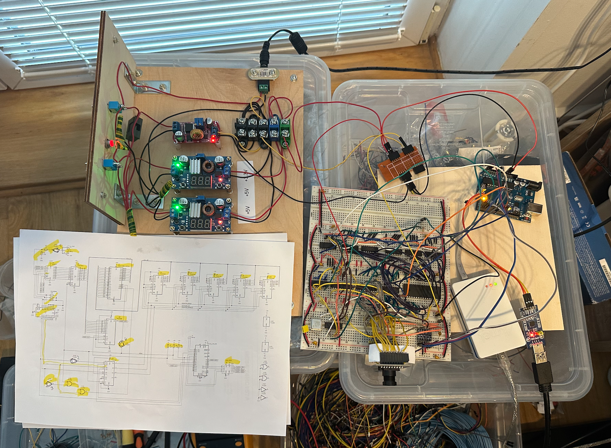
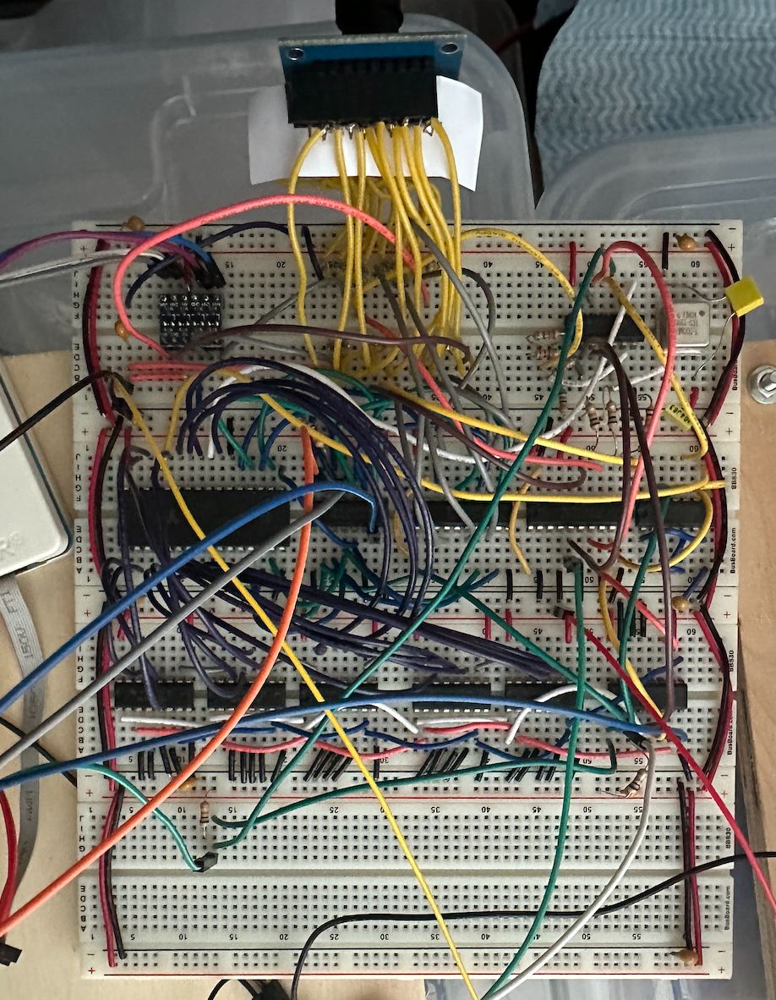
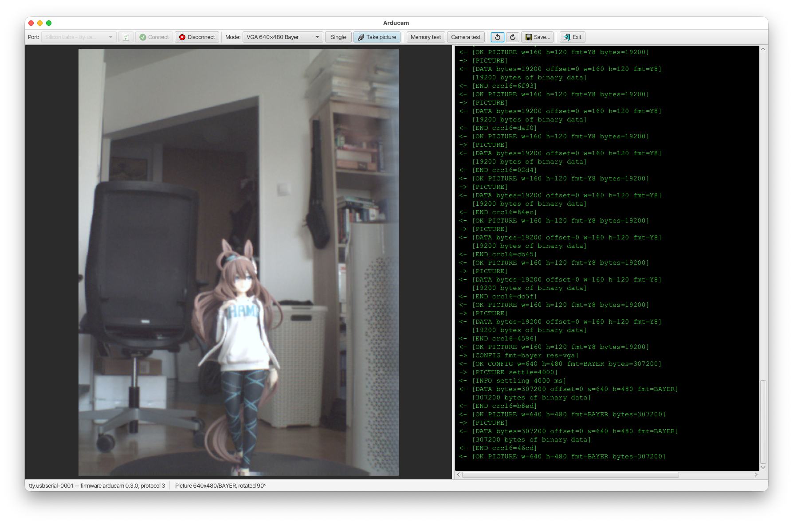
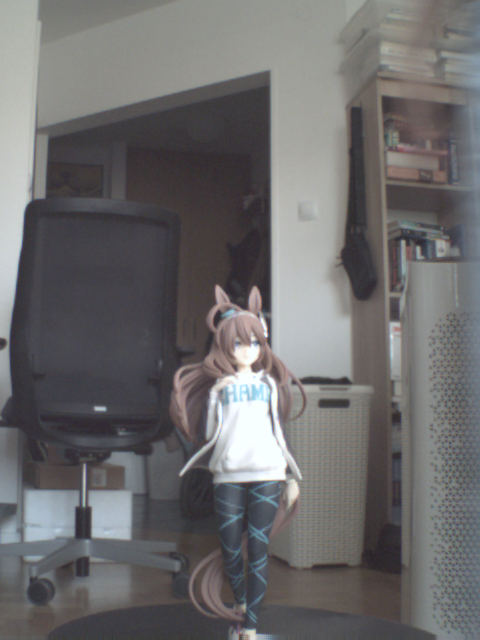

# Arducam

WARNING: Most of the code in this repository was vibe-coded by Claude Code. I did not spend too much time reviewing it. Use at your own risk.

Some time ago I ordered a bunch of OV7670 modules, I didn't know back then that they come in two
varieties: without FIFO and with FIFO.

"FIFO" here means that the module comes with a build in memory and the camera saves the picture to the memory first.
After that even the slow microcontroller like AVR328P, that we have in Arduino, can read the pixels at their own speed.

Unfortunately all my modules where the cheap one, without the build-in memory chip. Instead of trowing them away I decided to add the
memory chip myself. It worked better than I expected. Here I present the results of this hack.

Start by taking look at the [schematic](./kicad/arducam/plot/arducam.pdf), it shows how the memory chip is
connected to OV7670 module.

All the chips on the schematic should be 74HTC. I used what is by default in KiCad but if you want to
reproduce the build, use 74HTC chips.

In [Arduino](./arduino/) directory you will find two sketches:
1. `self-test` that you may use to validate the hardware part
2. `arducam` the actual firmware that works with the created Java FX app

To demonstrate how to use the hardware, I also created a simple Java FX application.
It requires Java 25+ to build and run.

Here is how the hardware actually looked like:



I used a cheap FTDI module to communicate with Arduino. If you want to use a regular USB connection, remember to update the
application source code. When you connect to serial via FTDI Arduino does not go though the chip reset procedure every time an app
opens the serial port. On the other hand when you connect via USB, every time an app opens a serial port Arduino goes though the reset.

I also used a cheap level-shifter module that converts between 5V <-> 3.3V.

Here is the application and a picture taken using the module:



Now the bad news: It takes some time to transfer the picture to the PC. Even at the QQVGA resolution it takes about 10s for the image to arrive.
For an VGA image it takes about 50 seconds. You may half that time by switching to Black&White mode.

# AI Generated description below

JavaFX application that connects to an Arduino via a serial port and displays
images captured by a simple camera module.

The firmware is in `arduino/arducam` (0.2.0+), the serial protocol (v2 and v3) is described in
[`arduino/PROTOCOL.md`](arduino/PROTOCOL.md). The application can:

- take pictures: QQVGA 160×120 YUYV, QVGA 320×240 YUYV, black and white
  QQVGA/QVGA (grayscale Y8, half the transfer time, firmware 0.3.0+),
  VGA 640×480 raw Bayer and a QQVGA colour bar test pattern,
- take pictures continuously (Loop mode) until stopped, like a (slow) movie
  camera: the camera is configured once, so only the first frame waits for
  auto exposure to settle; the frame rate is limited by the transfer time
  (QQVGA about 1.5 s per frame),
- run the firmware memory test and camera test,
- rotate pictures (by default they are rotated 90° clockwise, because
  the camera is mounted rotated) and save them as PNG or BMP.

The camera is powered on after connecting and powered off before disconnecting
(powering it on for each picture gives blurry pictures, auto exposure and
white balance need time to settle).
All commands and responses are logged, except binary image data.

How to build and run the app:
```
# Build the app
./mvnw clean install

# Run the app
./mvnw javafx:run -pl gui

# Run in the debug mode (waits for the debugger)
./mvnw javafx:run -pl gui -Pdebug
```

Serial port settings: 250000 baud, 8 data bits, 1 stop bit, no parity.
The Arduino is connected through an external USB-serial (FTDI) module,
so opening the port does not reset it.
Make sure that no other application (e.g. Arduino IDE Serial Monitor) is using the port.

This app is using `jSerialComm` library for serial communication with Arduino.
